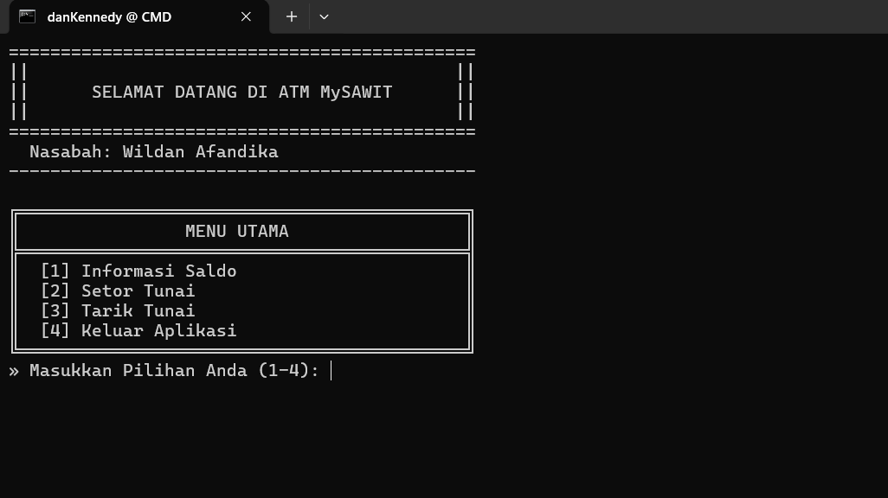
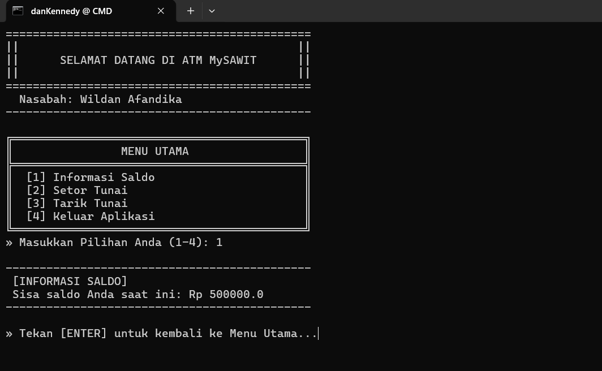
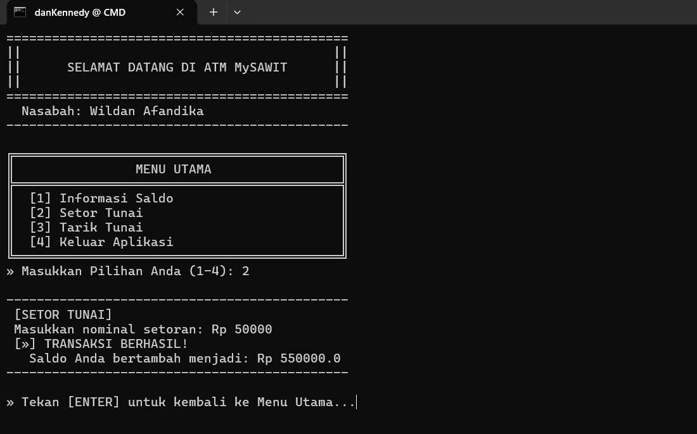
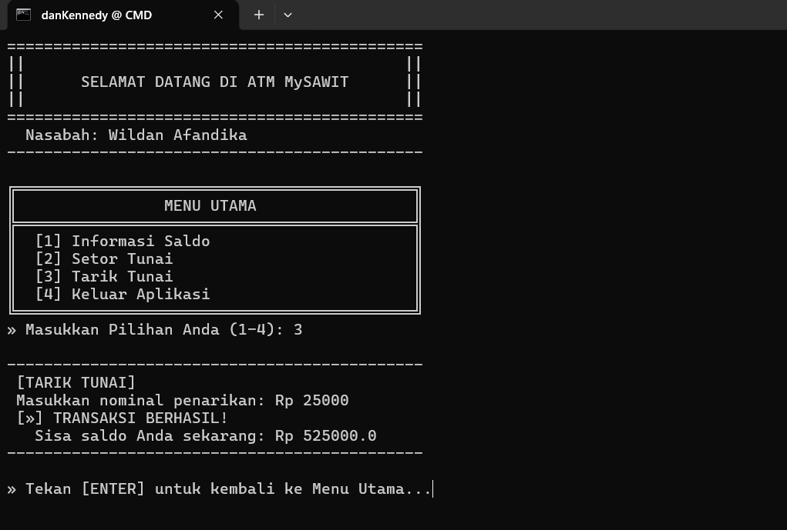

# 🏦 Simulasi Sistem Bank & ATM PBO

> **Identitas Mahasiswa**
> - **Nama:** Wildan Afandika
> - **NIM:** F1D02510141


Selamat datang di repositori proyek **Simulasi Sistem Bank & Mesin ATM Sederhana**. Proyek ini disusun sebagai bentuk pemenuhan Tugas Pemrograman Berorientasi Objek (PBO), dengan fokus utama pada **Latihan/Eksplorasi materi Array dan ArrayList** di dalam ekosistem Java. Melalui program ini, kita dapat melihat implementasi nyata bagaimana sebuah koleksi data *(Array/ArrayList)* digunakan untuk mengelola entitas secara dinamis.

---

## 📑 Daftar Isi
- [Fitur Utama](#-fitur-utama)
- [Struktur Proyek & Penjelasan Kelas](#-struktur-proyek--penjelasan-kelas)
- [Library Tambahan](#-library-tambahan)
- [Cara Menjalankan](#-cara-menjalankan)
- [Screenshot Eksekusi](#-screenshot-eksekusi)

---

## ✨ Fitur Utama
1. **Registrasi Nasabah**: Bank mampu menampung hingga 100 nasabah yang didaftarkan ke dalam memori menggunakan struktur data _Array_.
2. **Manajemen Akun Ganda**: Setiap nasabah diberikan fleksibilitas untuk memiliki maksimal 5 akun / rekening yang berbeda.
3. **Validasi Saldo Pintar**: Sistem menolak penarikan tunai apabila saldo tidak mencukupi, serta menolak angka minus (kurang dari nol) untuk keamanan transaksi.
4. **UI ATM Interaktif**: Program utama menyajikan menu terminal (CLI) interaktif yang meniru antarmuka mesin ATM asli, lengkap dengan pembersihan layar (*clear screen*) otomatis.

---

## 🏗️ Struktur Proyek & Penjelasan Kelas

Proyek ini dipisahkan menjadi 4 kelas utama yang saling berelasi:

### 1. `Akun.java`
Bertugas sebagai representasi *rekening bank*.
- Menyimpan jumlah `saldo` nasabah dengan keamanan tingkat perlindungan (akses *protected*).
- Memiliki fungsi `setor()` untuk menambah uang dan `tarik()` untuk mengambil uang.
- Mengembalikan nilai *boolean* (`true`/`false`) untuk memvalidasi sukses atau gagalnya sebuah transaksi.

### 2. `Nasabah.java`
Merepresentasikan entitas pelanggan (nasabah) di dunia nyata.
- Menyimpan informasi detail pelanggan seperti `namaDepan` dan `namaBelakang`.
- Mengeksplorasi penggunaan materi *Array of Objects* lewat variabel `daftarAkun` yang berperan membatasi kapasitas kepemilikan rekening hingga maksimal 5 akun per orang.

### 3. `Bank.java`
Berperan sebagai pengelola data bank terpusat.
- Menggunakan pendekatan *Array of Objects* untuk menampung dan meregistrasi kapasitas objek nasabah.
- Menjadi titik jembatan untuk mencari dan memanggil profil data seorang nasabah menggunakan *index*.

### 4. `Main.java`
Kelas *Driver* atau pintu masuk utama (*Entry-Point*) berjalannya aplikasi.
- Mensimulasikan inisialisasi entitas Bank, mendaftarkan nasabah bernama **Wildan Afandika**, lalu mengalokasikan akun dengan saldo awal Rp 500.000.
- Mengeksekusi blok perulangan *do-while* untuk menyajikan menu interaktif yang senantiasa aktif hingga pengguna memilih opsi untuk keluar.

---

## 🛠️ Library Tambahan

Proyek ini menggunakan _library_ utilitas bawaan standar dari Java, yaitu:
- **`java.util.Scanner`**: Berfungsi sebagai *listener* atau penangkap ketikan dari pengguna (*user input*). Digunakan secara intensif di kelas `Main.java` untuk membaca angka navigasi pilihan Menu ATM dan menangkap nilai nominal uang yang ingin disetor/ditarik.
- **`System.getProperty` & `ProcessBuilder`**: (Tambahan Opsional) Dimanfaatkan secara spesifik dalam logika untuk memicu pembersihan layar terminal *(Clear Screen)*, yang mampu mendeteksi secara otomatis *Operating System* milik pengguna (Windows/Linux/Mac).

---

## 🚀 Cara Menjalankan

1. Pastikan Anda telah menginstal **Java Development Kit (JDK)** di perangkat Anda.
2. Buka terminal/CMD dan arahkan *(cd)* ke direktori proyek ini.
3. Lakukan kompilasi (*compile*) seluruh file sumber Java ke folder `bin` dengan perintah:
   ```bash
   javac -d bin src/*.java
   ```
4. Jalankan kelas utama dengan menjalankan perintah:
   ```bash
   java -cp bin Main
   ```

---

## 📸 Screenshot Eksekusi

- **Tampilan Awal:**  
  

- **Tampilan Cek Saldo:**  
  

- **Uji Coba Setor Tunai:**  
  

- **Uji Coba Tarik Tunai:**  
  
